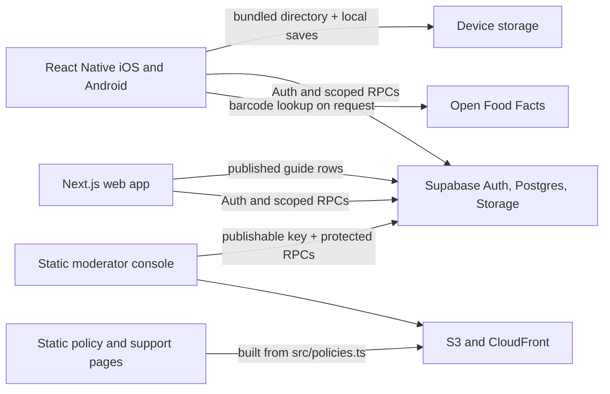

# INSTEAD

INSTEAD is a practical directory of everyday product alternatives and household or personal-care recipes. It helps people find options, understand how they are presented, and see the limits and cautions attached to them. The content is educational: natural ingredients, community votes, and editorial approval do not establish that a recipe is safe or effective.

This repository contains three related experiences: the React Native mobile app, a Next.js guide-directory web app, and a small static public-policy site with a private moderator console. Their data paths differ, so changes and deployments are not interchangeable.

## Product behavior

- **Browse without an account.** Search and filter the guide directory, open recipe details and photos, scan a product barcode, and save guides on the current device.
- **Scan optionally.** The mobile scanner sends the barcode to Open Food Facts to look up product name/category data. INSTEAD does not retain the barcode, lookup result, camera image, or scan history. Scanning is not required to browse.
- **Create an account when useful.** Email/password accounts require email confirmation. A profile has a public username and optional bio. Signing in syncs saved-guide identifiers across devices and enables recipe submissions, recipe votes, reports, and private management of a user's own submissions. Passwords are handled by Supabase Auth, not stored by the app.
- **Contribute recipes.** A signed-in user can submit a recipe with ingredients and quantities, instructions, storage information, cautions, optional attribution, and up to three optional photos. Submissions remain private until an administrator reviews them. Contributors can withdraw their own submissions, report content, and block other contributors.
- **Use public profiles narrowly.** Approved community recipes link to their author's username and optional bio. Email addresses, saved guides, and pending submissions are private. The app has no public comment feed; legacy comment tables are retained only where needed for compatibility, historical cleanup, and account deletion.
- **Moderate separately.** The private `/admin` console supports community review, reports, restrictions, deletion requests, activity history, and editing/adding/archiving bundled recipes. Admin membership and recent multi-factor verification are enforced by Supabase for each protected operation.

For the exact auth, privacy, moderation, deletion, and release procedures, see [community setup](docs/community-setup.md), [admin operations](docs/admin-panel.md), [moderation](docs/moderation-runbook.md), and [release safety](docs/release-safety.md).

## System architecture



| Component                            | Responsibility                                                                      | Runtime data source                                                                                                                                                                                                                                                                             |
| ------------------------------------ | ----------------------------------------------------------------------------------- | ----------------------------------------------------------------------------------------------------------------------------------------------------------------------------------------------------------------------------------------------------------------------------------------------- |
| `src/`, `ios/`, `android/`           | React Native mobile app and native platform shells                                  | Mobile guide topics and baseline recipes are bundled in `src/catalog.ts`; the app overlays administrator-managed recipe edits from the `builtin_recipe_catalog` RPC. Community content, account state, votes, and cloud saves use scoped Supabase RPCs. Local saves remain available on-device. |
| `web/`                               | Next.js guide-directory application                                                 | Reads published rows from Supabase `public.guides`; account and community features use Supabase Auth/RPCs. Its production hosting is separate from the static-site deployment in this repository's CI workflow.                                                                                 |
| `website/`                           | Script-free policy/support pages plus the static `/admin` console                   | Policy text comes from `src/policies.ts`. The admin shell embeds only the Supabase URL and public publishable key; each privileged operation is authorized by the database. CI publishes this directory's generated `website/dist/` to the dedicated S3 bucket and invalidates CloudFront.      |
| `supabase/`                          | SQL schema, security-definer RPCs, grants, RLS/storage policies, and database tests | PostgreSQL/Auth/Storage. Client applications use the public publishable key and authenticated user session; no service-role key belongs in a client.                                                                                                                                            |
| `supabase/functions/delete-account/` | Account deletion orchestration                                                      | Verifies the caller with Supabase Auth, removes that account's recipe photos from Storage, then deletes the Auth user so dependent rows cascade. The service-role secret is confined to the Edge Function environment.                                                                          |

### Main technologies

| Area               | Implementation                                                                                            |
| ------------------ | --------------------------------------------------------------------------------------------------------- |
| Mobile UI          | React Native 0.86.2, React 19.2.3, TypeScript, React Native Community CLI                                 |
| Native shells      | iOS/Xcode and Android/Gradle; native projects are committed and built independently                       |
| Guide web app      | Next.js 16.4.2, React 19.2.8, TypeScript                                                                  |
| Backend            | Supabase Auth, PostgreSQL, Storage, RPCs, and an Edge Function                                            |
| Client persistence | AsyncStorage on mobile; browser storage for local web saves; private Supabase RPCs for cross-device saves |
| Quality            | Jest, PostgreSQL integration scripts, ESLint, Prettier, TypeScript, and platform builds in GitHub Actions |

The mobile catalog is not a live copy of `public.guides`: it starts from the bundled TypeScript catalog, then asks Supabase for built-in recipe overrides on launch, when the app returns to the foreground, and every four minutes. A network/database failure leaves the bundled experience intact. The Next.js app reads the published `guides` table directly with no-store requests. The SQL `schema.sql` and `seed.sql` concern that guide table; they do not seed the mobile TypeScript catalog.

This split makes content operations different: an authorized administrator can edit, add, archive, or restore built-in recipe text in Supabase without a mobile software release. Clients receive those changes at their next successful catalog refresh. The editor does not change bundled photos. Changes to native screens, catalog structure, or other bundled code still require a software release.

### Security boundaries

- Supabase Auth owns password verification, email confirmation, and persisted sessions. Community writes require a confirmed, non-anonymous account and accepted current policies.
- Community tables are accessed through narrow RPCs, not broad client table grants. Database checks enforce ownership, status, vote limits, moderation visibility, and account restrictions.
- Recipe photos are stored privately. Uploads are constrained to an account-owned opaque folder; administrators and permitted readers receive short-lived signed URLs.
- Admin access requires explicit `community_admins` membership and verified TOTP-based MFA in addition to an authenticated session. The URL and client UI are not authorization controls.
- The public Supabase publishable key is expected in client builds. Never expose a Supabase secret/service-role key, signing credential, or store credential in the mobile app, web app, static admin, or repository.
- Account deletion can remain pending if Storage cleanup fails; the UI records status and permits retry/operator follow-up. A recorded request alone does not mean every file has already been removed.

## Repository map

```text
App.tsx                         Mobile app entry point
src/catalog.ts                  Bundled topics, guide copy, and baseline recipes
src/navigation/                 App view routing and state
src/screens/, src/components/    Mobile user interface
src/lib/, src/hooks/             Supabase, catalog overlay, auth, and app logic
ios/, android/                   Native iOS and Android projects
web/                             Next.js guide-directory app
website/                         Policy/support pages and admin-console source
supabase/                        Database migrations, RPCs, and SQL tests
supabase/functions/              Supabase Edge Functions
scripts/                         Environment, CI, build, release, and safety tooling
docs/                            Setup and operational runbooks
release/readiness.json           Store-release owner attestations
.github/workflows/               Quality, platform build, deployment, and release jobs
```

## Local development

### Requirements

- Node.js `>=22.11.0` for the repository; `web/` currently declares `>=22.13.0`.
- npm.
- For iOS: macOS, Xcode, and CocoaPods.
- For Android: Android Studio/SDK and JDK 17 for the CI-compatible build.

Install locked dependencies:

```bash
npm ci
npm --prefix web ci
```

For iOS, install Pods when native dependencies change or on a fresh checkout:

```bash
pod install --project-directory=ios
```

The mobile project uses the React Native Community CLI with committed native projects. It does not use Expo, Expo Go, or EAS.

### Configuration

Copy `.env.example` to `.env` for local development and set both Supabase values, or leave both blank for native offline development:

```text
SUPABASE_URL=https://your-project.supabase.co
SUPABASE_PUBLISHABLE_KEY=sb_publishable_...
SITE_URL=http://localhost:3000
SUPPORT_EMAIL=info@insteadtry.com
```

The root `postinstall` and `env:generate` scripts read environment variables (injected environment values take precedence over `.env`) and write ignored configuration files: `src/config/generatedEnv.ts` and `web/.env.local`. The public website app reads the generated `NEXT_PUBLIC_SUPABASE_URL` and `NEXT_PUBLIC_SUPABASE_PUBLISHABLE_KEY`. Keep URL and key together; the generator rejects a partial pair. Native offline mode can use bundled catalog content, but Supabase-backed account/community features and the web directory need live configuration.

`SITE_URL` supplies website/social metadata and defaults to localhost. `SUPPORT_EMAIL` defaults to `info@insteadtry.com`. In production the website builder requires the public Supabase URL and publishable key. Use only an HTTPS project URL in production. Never use a service-role or secret key in client configuration.

### Run

Start Metro and, in another terminal, run a platform:

```bash
npm start
npm run ios       # iOS simulator by default
npm run android   # running emulator or connected device required
```

Run the Next.js guide-directory app separately:

```bash
npm run web
```

Then open `http://localhost:3000`. The static policy/admin site is built separately with `npm run website:build`; its output is `website/dist/`.

## Supabase provisioning and migrations

For a **new Supabase project**, `supabase/schema.sql` creates the published guide table and `supabase/seed.sql` loads the web guide rows. Community features use separate migrations and do not replace the guide directory. For an **existing project**, do not replay one-time scripts. First check the current database and the migration notes in [community setup](docs/community-setup.md), [admin panel](docs/admin-panel.md), and [release safety](docs/release-safety.md); those documents describe required dependency order and rollout-specific operations.

At a high level, the community database is assembled from one-time base migrations (`community.sql`, then `recipes.sql`) followed by repeatable migrations. For a new install or schema audit, the dependency order is:

1. `community.sql`, then `recipes.sql` — one-time community and recipe tables.
2. `directory-topics.sql`, then `community-safeguards.sql` — repeatable topic registration and community security/moderation controls.
3. `admin-panel.sql` — repeatable admin tables and protected moderation RPCs.
4. `recipe-comments.sql` — legacy compatibility; later vote/catalog migrations depend on its recipe registry. The current app does not accept or show comments.
5. `recipe-voting.sql` — repeatable recipe ratings and vote writes.
6. `private-account-hub.sql` — repeatable profiles, private saves, and account hub functions.
7. `simplify-admin-review.sql` — repeatable review-field cleanup after safeguards and the admin schema.
8. `builtin-recipe-admin.sql` — repeatable built-in recipe editor after the recipe registry, voting, and admin schema.

The exact migration headers and the linked runbooks take precedence if an existing project is at a different migration state. `schema.sql` and `seed.sql` are separate guide-catalog setup for a new project; do not rerun one-time scripts on an existing database. Apply only the migration that is actually missing or changed, and never run the `*.test.sql` fixtures against a hosted/production database: they are designed for a disposable local PostgreSQL test database.

Deploy the `delete-account` Edge Function as documented in the release runbook. Its `SUPABASE_URL` and `SUPABASE_SERVICE_ROLE_KEY` secrets belong only in the Supabase Edge Function environment. Admin membership is an explicit owner-managed database grant; migrations do not make a signup an administrator.

## Quality checks

Run the standard project suite:

```bash
npm run verify       # Prettier, ESLint, TypeScript, native Jest tests
npm run safety:test  # repository safety and build-detection tests
npm run web:test     # Next.js production build and rendered HTML tests
npm run web:build    # Next.js production build only
npm run release:check # owner attestations required before public store release
```

CI also runs the native SQL integration suite against a disposable local PostgreSQL cluster, builds the static policy/admin site, lints and builds the Next.js app, and runs platform-change detector tests. SQL test fixtures explicitly roll back; do not point them at a live Supabase project.

## CI, deployment, and store releases

`.github/workflows/ci.yml` runs for pull requests and pushes to `main`:

- Quality/security checks run for every change.
- Android debug and iOS simulator builds run independently when their platform or shared mobile code changes. Web-only and documentation-only changes skip native builds; `.github/workflows/ci.yml` and `scripts/detect-platform-changes.mjs` define the current classification.
- After successful CI on `main`, the static policy site and admin console are rebuilt and deployed to S3/CloudFront. The Next.js `web/` app is built and tested in CI, but this deploy job does not publish it.

After successful main-branch CI, `.github/workflows/mobile-release.yml` detects mobile-impacting changes and, when applicable, creates a signed Android App Bundle and uploads it to Google Play **Internal Testing**, and/or archives and uploads iOS to **TestFlight**. Android and iOS builds use separate version counters and platform credentials. Artifacts are retained for 14 days. A manual dispatch on `main` selects both platforms. These jobs do not publish a public Google Play production or Apple App Store release.

The public store checklist is separate from beta distribution. `npm run release:check` reads `release/readiness.json` and fails until the required owner attestations are complete. This is a manual local check; it is not currently a dependency of CI or the mobile beta-upload workflow. It is not a legal review or a guarantee of store approval. Do not infer public-launch readiness from successful CI, a TestFlight upload, or an Internal Testing upload. See [release safety](docs/release-safety.md) for the current owner decisions and disclosure checks.

In the current tracked `release/readiness.json`, the legal operator name, jurisdiction, and moderation owner are unset; legal review and store declaration review are incomplete. The policy and support-site checks are marked complete. Consequently the public-release check remains blocked until the responsible owner completes the required attestations.

### Build signing configuration

Release workflows read store credentials from the protected GitHub `production` environment. Android expects these GitHub variables: `APP_VERSION`, `ANDROID_PLAY_PACKAGE_NAME`, `ANDROID_PLAY_TRACK`, and `ANDROID_PLAY_RELEASE_STATUS`; and secrets: `ANDROID_UPLOAD_KEYSTORE_BASE64`, `ANDROID_UPLOAD_KEYSTORE_PASSWORD`, `ANDROID_UPLOAD_KEY_ALIAS`, `ANDROID_UPLOAD_KEY_PASSWORD`, and `ANDROID_PLAY_SERVICE_ACCOUNT_JSON`. iOS expects variables `IOS_TEAM_ID`, `IOS_PROFILE_NAME`, `APP_STORE_CONNECT_API_KEY_ID`, and `APP_STORE_CONNECT_API_ISSUER_ID`; and secrets `IOS_DISTRIBUTION_CERTIFICATE_P12_BASE64`, `IOS_DISTRIBUTION_CERTIFICATE_PASSWORD`, `IOS_PROVISIONING_PROFILE_BASE64`, and `APP_STORE_CONNECT_API_PRIVATE_KEY_BASE64`. Both platforms require `SUPABASE_URL` and `SUPABASE_PUBLISHABLE_KEY` as environment variables. Never commit or print their secret values.

## Product and safety limits

INSTEAD is an educational directory, not a healthcare provider or medical device. It does not diagnose, treat, cure, or prevent medical conditions. DIY formulas may be owner-supplied and untested; read each recipe's cautions and seek qualified advice for medical, dental, pest, or other safety questions. Voting reflects preference, not evidence. Public community submissions are moderated before publication, but moderation does not certify them. See the in-app Info screen and the public policy pages for user-facing notices.
