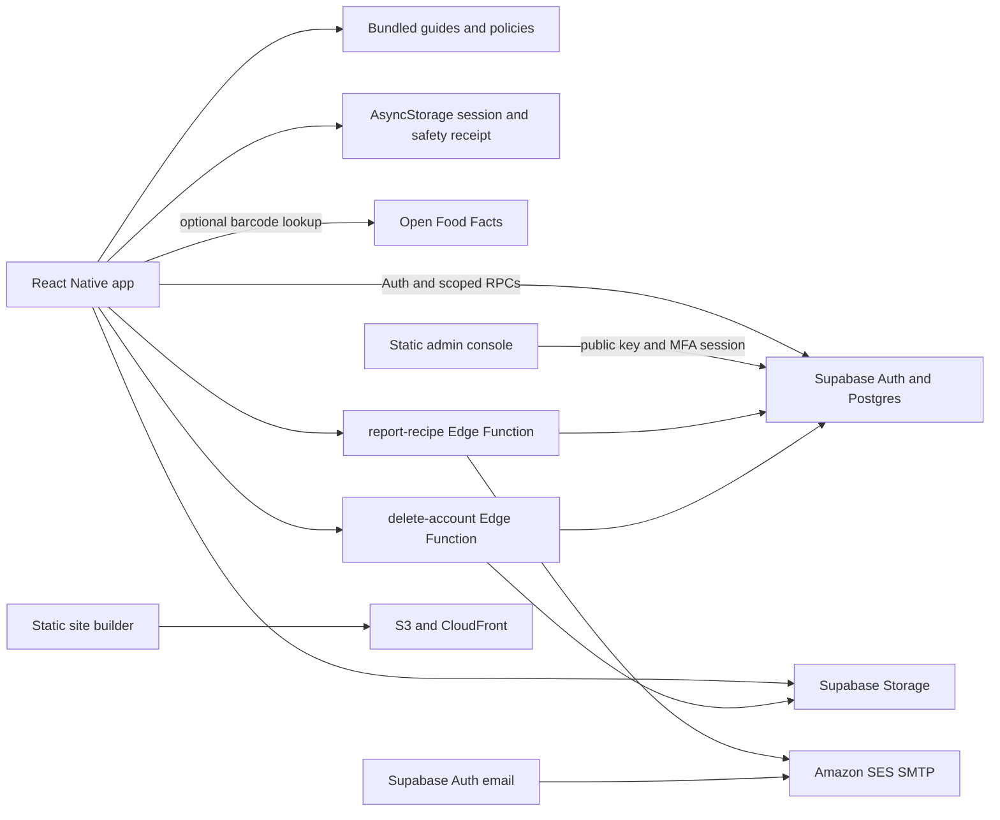

# INSTEAD

INSTEAD is an educational directory of everyday product alternatives and household or personal-care recipes. People can browse guides, read cautions, save useful content to an account, and submit recipes for moderation. Natural ingredients, community votes, and publication do not establish safety or effectiveness.

This repository contains the **React Native iOS/Android app**, the **static public website and private admin console**, and the **Supabase backend and deployment tooling**. It uses committed native projects, not Expo, Expo Go, or EAS. The website is built locally and hosted on S3/CloudFront; it is not a web version of the mobile app or a Next.js server.

Documentation audited against repository source on **November 5, 2026**. Features described here reflect this branch. A merged PR, deployed SQL, updated website, uploaded binary, installed beta, and approved store release are separate states; one does not prove the others are complete.

## Product behavior

| Area                | Current behavior                                                                                                                                                                                                                                                                                                                  |
| ------------------- | --------------------------------------------------------------------------------------------------------------------------------------------------------------------------------------------------------------------------------------------------------------------------------------------------------------------------------- |
| First use           | An explicit, versioned safety acknowledgement gates the mobile directory. Safety, Terms, and Privacy remain readable before acceptance.                                                                                                                                                                                           |
| Home                | Guests can search/filter the bundled guide directory, read guides and recipes, view available photos, and optionally scan a barcode.                                                                                                                                                                                              |
| Navigation          | The menu contains **Home**, **My INSTEAD**, **Saved**, and **Info & Safety**. Guide, barcode-result, and contributor-profile screens are additional routes.                                                                                                                                                                       |
| Saved               | Saving **guides and individual recipes requires a verified, non-anonymous account**. Saved lists both, synchronizes account-owned bookmarks, and opens an individual recipe at its exact card. Guests see registration/sign-in actions. My INSTEAD does not duplicate the saved lists.                                            |
| Account             | Email/password signup, confirmation/recovery, public username, optional bio/avatar, private submissions, sign-out, and account deletion. No report/block management lists.                                                                                                                                                        |
| Submissions         | Verified, active contributors who accept the current community terms can submit recipe text and up to three photos. Pending submissions are private. Approval publishes them alongside catalogue recipes; authors retain private submission-management controls.                                                                  |
| Votes               | Up/down votes express preference. Pressing the selected vote removes it. The displayed card updates without an immediate vote-driven list reorder; ranking is refreshed separately. Community authors cannot vote on their own submissions.                                                                                       |
| Reports             | Every published recipe offers Report or raise a concern. The server records and emails the report, then permanently excludes the recipe for the reporter. For community recipes, the contributor and their recipes are also excluded. Others retain access until explicit global moderation/removal.                              |
| Personal exclusions | Reporting is the only recipe moderation action and is final for that account; there is no separate block button. Catalogue recipes are excluded individually; community actions also exclude the contributor across guides, Saved, and profiles. There are no Hidden recipes, Blocked contributors, restore, or unblock controls. |
| Concern history     | No user-facing history, review, or management UI. Legacy history/block-list APIs return no entries and restore/unblock writes are denied. Admin review does not undo personal exclusion.                                                                                                                                          |
| Info & Safety       | Bundled policies, safety/support links, and `Version … (Build …)` read from the installed native binary. `package.json`, a green CI check, and the latest repository commit are not the installed build number.                                                                                                                   |
| Admin               | Separate email-code + authenticator login; Pending recipes, unified Recipes, restrictions/deletion requests, Users, and Activity log. Required fields and sensitive actions use explicit labels/dialogs.                                                                                                                          |

There is no current public comment feed, paid-content/IAP implementation, or AI generation service in this source tree. Legacy comment tables/functions remain for compatibility and deletion, not as active app features.

### Accounts and local state

Normal mobile sign-in uses a password. Signup checks public username availability before requesting email confirmation and offers a 60-second confirmation-code resend cooldown; recovery uses a Supabase **recovery** code and a five-minute verified password-reset window. Restored sessions and foreground returns validate the live Auth identity before showing account data; sign-out resets credential fields and password visibility. Supabase handles password verification; the app does not persist plaintext passwords. Supabase retains a pending, unverified Auth identity for its confirmation challenge, but public profile creation requires verified email. A final username collision leads to a recoverable profile-setup form; it does not repeat registration or verification. Password fields have accessible clear controls that restore hidden entry.

The native Supabase client persists its session in **AsyncStorage** and refreshes tokens while active. AsyncStorage also holds the local safety acknowledgement; it is not a documented hardware-backed credential vault. Saved content is account-owned in Supabase. Old device-wide bookmarks are neither displayed nor imported because their owner cannot be established. Signing out clears the account view; signing back in reloads that account's data. Saves require connectivity for server synchronization and writes; offline browsing does not provide anonymous saving.

Public contributor profiles expose username, optional bio/avatar, and eligible approved recipes. Email, saved items, pending submissions, private reports, and hidden preferences are not public profile data. Avatar images are intentionally public; recipe photos use private Storage and short-lived signed URLs.

### Reporting, review, and deletion

- A report reason/details and canonical recipe snapshot go privately to `info@insteadtry.com`. Clients cannot choose the recipient or trusted reporter identity. Emails have HTML and plain-text versions. Reporting a community recipe also permanently excludes its contributor for that account.
- Each account gets one immutable concern per recipe, even after review. Concurrent requests serialize per account. Limits are **10 new concerns/hour**, **30/day**, and **30 successful submission/retry requests/hour**; rate-limited calls return HTTP 429.
- Email sends use a five-minute claim. Completed receipts are not resent. A failed delivery preserves the concern and permits retry; there is **no unattended retry worker**. Delivery can be duplicated if SMTP accepts it but saving the receipt fails.
- Permanent exclusion writes check the expected account and allow 60 operations/hour. Excluded recipes never appear in guides, Saved, public profiles, or My INSTEAD submissions for that account. Affected recipe bookmarks are removed for that account only. No client API can restore/unblock them; public catalogue data and other users remain unchanged.
- The admin reviews the exact displayed concern snapshot. Review alone does not unpublish content. Catalogue archive and community removal are explicit global actions. Report counts do not automatically remove recipes.
- User and authorized-admin deletion both remove recipe photos/avatars before hard-deleting Auth and cascading account data. Failed cleanup stays pending, hides public contributions, and allows retry. The mobile UI shows deletion progress rather than a transient missing-profile error.
- Audit cleanup removes linked identifiers and redacts affected retained snapshots; an anonymous completion receipt can remain. Already-delivered support emails, provider logs/backups, and copies on other devices have separate retention. Do not promise that deletion retracts those copies.

See [permanent exclusion behavior](docs/permanent-recipe-exclusions.md), [recipe publication and reports](docs/recipe-publication-and-reports.md), [moderation](docs/moderation-runbook.md), and [admin operations](docs/admin-panel.md).

## Architecture and external services



| Component/service                               | Responsibility and boundary                                                                                                                                                                                                                          |
| ----------------------------------------------- | ---------------------------------------------------------------------------------------------------------------------------------------------------------------------------------------------------------------------------------------------------- |
| React Native 0.86.2 / React 19.2.3 / TypeScript | Native app, view routing, state, lists, accessibility, photo picker, barcode scanner, Lucide icons, and SVG rendering.                                                                                                                               |
| Bundled catalogue + Supabase overrides          | `src/catalog.ts` supplies topics/baseline recipes. `builtin_recipe_catalog` overlays admin edits/additions/archive state at launch, foreground, community refresh, and four-minute intervals. A failed refresh retains the last available catalogue. |
| Supabase Auth/Postgres                          | Passwords, email confirmation/recovery, account state, policy acceptance, profiles, moderation, saves, votes, blocks, concerns, and private visibility. Narrow RPCs enforce authorization independently of UI.                                       |
| Supabase Storage                                | Private recipe photos (JPEG/PNG/WebP, up to 5 MiB each, up to three per submission) and public optional avatars (up to 2 MiB). Upload policies constrain ownership and account state.                                                                |
| Supabase Edge Functions                         | `delete-account` orchestrates authenticated Storage-first deletion; `report-recipe` stores concerns and sends report emails. Privileged keys stay server-side.                                                                                       |
| Amazon SES                                      | Custom SMTP for Auth email and separate sender-restricted SMTP credentials for recipe reports. Outgoing delivery does not prove an inbound support inbox works.                                                                                      |
| Open Food Facts                                 | Optional lookup of the scanned barcode using the API in `src/lib/barcodeLookup.ts`. INSTEAD does not persist camera frames or barcode history. The external request still reaches a third party; the lookup currently requests US/English metadata.  |
| S3/CloudFront                                   | Public policy/support pages, catalogue snapshot used for report enrichment, and static `/admin` shell. Admin data comes from protected Supabase requests, not embedded private records.                                                              |
| GitHub Actions / stores                         | Validation, static-site deployment, signed AAB/IPA creation, Google Play upload, and App Store Connect upload. Store processing/review is separate.                                                                                                  |

The optional `public.guides` table and `fetchPublishedGuides` helper are **not** the source used by `AppNavigator`. `schema.sql`/`seed.sql` are legacy/separate guide-table setup; they do not seed the bundled TypeScript catalogue. There are no realtime database subscriptions: refreshes and scoped client notifications update content. Offline clients can retain previously fetched content until a successful refresh.

Admin catalogue text changes can reach clients without a new binary. Packaged photos, topic structure, screens, and other bundled code require a software release. Stable IDs (`builtin:…`, `admin:…`, and community UUIDs) preserve saves, ratings, attribution, and report references across edits.

## Repository map

| Path                                                           | Responsibility                                                                                                                                          |
| -------------------------------------------------------------- | ------------------------------------------------------------------------------------------------------------------------------------------------------- |
| `App.tsx`, `index.js`                                          | Native entry, safe areas, error boundary, and native version/build context.                                                                             |
| `src/catalog.ts`, `src/categories.ts`, `src/types.ts`          | Bundled directory, categories, and data types.                                                                                                          |
| `src/navigation/`                                              | View history/back behavior, menu routes, personal catalogue filtering, Saved destinations, and scanning entry.                                          |
| `src/screens/`, `src/components/`                              | Directory/detail, account/profile, Saved, barcode, policy screens, forms, moderation-related controls, and reusable UI.                                 |
| `src/hooks/`                                                   | Auth/account lifecycle, recipe pagination, catalogue refresh, account saves, personal hiding, scroll targeting/restoration, and safety acknowledgement. |
| `src/lib/`                                                     | Supabase client/RPC helpers, barcode mapping, image byte validation, recipe IDs/ranking/ratings, notifications, and build metadata.                     |
| `src/policies.ts`, `src/disclaimer.ts`, `src/safetyNotices.ts` | Shared policy text, policy version/receipt parsing, and safety notices.                                                                                 |
| `ios/`, `android/`, `assets/`                                  | Committed native shells, manifests/permissions, build metadata bridges, icons, and packaged media.                                                      |
| `website/`, `scripts/build-policy-site.mjs`                    | Static public pages, admin source, and generated `website/dist/`. No independent web dependency installation.                                           |
| `supabase/*.sql`, `supabase/functions/`                        | Ordered database upgrades and the two server-side functions.                                                                                            |
| `__tests__/`, `supabase/tests/`, `scripts/test-*.mjs`          | App regressions, disposable database fixtures, backend/security and workflow tests.                                                                     |
| `scripts/`                                                     | Environment/icons generation, static builds, production audit, avatar readiness, build reservations, Play upload, release gating, and test harnesses.   |
| `vendor/deepmerge/`, `patches/`                                | Reviewed local dependency fork and install-time compatibility patches.                                                                                  |
| `.github/workflows/`                                           | CI and reusable/manual mobile releases.                                                                                                                 |
| `docs/`, `release/`                                            | Operational guides, dated audits/interview notes, store materials, and owner attestations. Store drafts/artifacts are not deployment evidence.          |

## Local development

### Requirements and installation

- Node.js **22.11.0 or newer** and npm; CI uses Node 22.
- iOS: macOS, Xcode, CocoaPods. CI pins **Xcode 26.3**; the project deployment target is iOS **15.1**, with iPhone/iPad device families.
- Android: Android SDK/Studio and **JDK 17**. Checked-in configuration uses min SDK **24**, compile/target SDK **36**, build tools **36.0.0**, and NDK **27.1.12297006**.
- Database tests: Python 3 and local PostgreSQL binaries (`initdb`, `pg_ctl`, `psql`). Set `INSTEAD_PG_BIN` if they are not discovered; the macOS fallback is Homebrew PostgreSQL 15.

```bash
npm ci
cp .env.example .env
# Edit .env if account/backend features are needed.
pod install --project-directory=ios  # macOS: fresh checkout or native dependency changes
```

`npm ci` verifies the reviewed deepmerge fork, applies tracked `patch-package` patches, and generates native public configuration. Do not skip install scripts to work around a failing dependency integrity check.

### Public configuration

```text
SUPABASE_URL=https://your-project.supabase.co
SUPABASE_PUBLISHABLE_KEY=sb_publishable_...
```

Set both values, or leave both blank for offline native development. Injected environment values take precedence over `.env`; `npm run env:generate` writes ignored `src/config/generatedEnv.ts`. Never edit/commit that generated file. Start/test/typecheck scripts regenerate it. Offline mode has bundled guides/policies but no live account, save, voting, submission, or report operations.

Use HTTPS for hosted configuration. The static builder checks the public key type and rejects privileged credentials; a service-role key, SMTP password, signing key, or store credential must never enter client configuration.

### Run and build

```bash
npm start
# Another terminal:
npm run ios
npm run android

# Static public website + admin:
npm run website:build
```

Website output is `website/dist/`; serve that directory with a local static server when inspecting pages. `/admin` requires a configured backend and an authorized MFA account. The mobile app uses the public native configuration, not an admin credential.

`npm run icons:generate` regenerates platform icons from the repository's icon source. Environment/icon generation, native dependency changes, and binary build metadata require the appropriate rebuild; changing an installed app's package files does not update its native binary.

## Backend provisioning and migration order

Use [supabase/README.md](supabase/README.md) as the ordered SQL runbook. **Merging code does not apply hosted SQL, Auth settings, SMTP secrets, or Edge Functions.** Inventory an existing project before running any migration. Never replay the two one-time base migrations or run test fixtures in production.

| Order | SQL file(s)                                        | Purpose                                                                                                                       |
| ----- | -------------------------------------------------- | ----------------------------------------------------------------------------------------------------------------------------- |
| 1     | `community.sql`, `recipes.sql`                     | One-time community and recipe base tables.                                                                                    |
| 2     | `directory-topics.sql`, `community-safeguards.sql` | Topic registration, confirmed/active contributors, policy receipts, moderation/blocking, and photo ownership.                 |
| 3     | `admin-panel.sql`                                  | Private admin membership/bootstrap and protected moderation operations.                                                       |
| 4     | `recipe-comments.sql`                              | Legacy compatibility and shared recipe registry; not an active comment UI.                                                    |
| 5     | `recipe-voting.sql`                                | Catalogue registration and recipe votes.                                                                                      |
| 6     | `private-account-hub.sql`, `profile-avatars.sql`   | Private saves/account data and optional public avatars.                                                                       |
| 7     | `simplify-admin-review.sql`                        | Review-field cleanup and rejected-content Trash behavior.                                                                     |
| 8     | `builtin-recipe-admin.sql`                         | Catalogue editor, additions, archive/restore, and audit.                                                                      |
| 9     | `recipe-saves-and-admin-users.sql`                 | Individual recipe saves and admin user directory.                                                                             |
| 10    | `admin-user-deletion.sql`, `admin-membership.sql`  | Authorized admin deletion and audited admin grants.                                                                           |
| 11    | `account-deletion-privacy.sql`                     | Shared Auth-deletion audit cleanup and anonymous completion receipts.                                                         |
| 12    | `recipe-concerns.sql`                              | Canonical concerns, immutable receipts, quotas, delivery claims, and admin resolution.                                        |
| 13    | `recipe-concern-history.sql`                       | Historical private-history schema; current client reads/restoration are disabled by the final migration.                      |
| 14    | `personal-recipe-visibility.sql`                   | Initial private recipe filtering and report-trigger schema; apply the permanent override next.                                |
| 15    | `permanent-recipe-exclusions.sql`                  | Permanent report/block scope, no user history/management, legacy undo rejection, contributor exclusion, and bookmark cleanup. |

Apply `signup-integrity.sql` after the table above: it adds a public boolean username preflight and a verified-only profile-write trigger, with no existing-account deletion. Apply `session-account-state.sql` afterward to reject phantom account status/private ownership for deleted JWT subjects. See the [session restoration audit](docs/session-restoration-audit.md) for behavior, checks, and device QA.

Apply changed repeatable files in dependency order. Later scripts replace earlier RPCs: always reapply their dependent overrides, ending with `permanent-recipe-exclusions.sql` then `signup-integrity.sql` and `session-account-state.sql`, after changing an earlier definition. The permanent migration reconciles previous reports/blocks, including earlier restores, once; reapplication does not remove exclusions. For new bundled IDs, update the vote registry (`recipe-voting.sql`); the admin editor registers its own additions.

`schema.sql` and `seed.sql` are separate guide-table setup, outside this community sequence. The disposable test harness also models historical upgrade states; its fixture SQL is not a production installer.

### Edge Functions and Auth settings

Deploy `delete-account` and `report-recipe` from `supabase/functions/` after their database dependencies. Keep platform JWT verification enabled and retain the handlers' authoritative Auth checks. Use the installed Supabase CLI's deployment flags; do not copy obsolete CLI invocations blindly. Database/Edge deployments are operator actions, not part of the current GitHub website/mobile jobs.

| Setting                                                                                              | Where it belongs                                                                                                     |
| ---------------------------------------------------------------------------------------------------- | -------------------------------------------------------------------------------------------------------------------- |
| `SUPABASE_URL`, `SUPABASE_PUBLISHABLE_KEY`                                                           | Public mobile/website build configuration.                                                                           |
| `SUPABASE_SERVICE_ROLE_KEY`                                                                          | Supabase Edge Function environment only; used by both privileged handlers.                                           |
| `REPORT_SMTP_HOST`, `REPORT_SMTP_PORT`, `REPORT_SMTP_USER`, `REPORT_SMTP_PASS`, `REPORT_SMTP_SENDER` | `report-recipe` server secrets only; port 465 uses TLS and other configured ports use the transport's SMTP behavior. |
| Auth SMTP credentials, email templates, OTP lifetime, password/security switches                     | Supabase Auth configuration, separate from report SMTP and SQL migrations.                                           |

The last recorded Auth security rollout set eight-digit email codes with **300-second expiry**, minimum password length **10**, confirmation/secure email change enabled, and anonymous sign-in/manual identity linking disabled. Recovery uses the recovery template/token type. Hosted settings must be verified for each environment; a client countdown is not a server expiry policy. The owner retained the Free plan, so the recorded rollout does not include paid leaked-password protection. See [Auth security review](docs/admin-auth-security-review.md) for dated evidence and rollout constraints, and [email delivery diagnostics](docs/email-delivery-diagnostics.md) for sender authentication and missing-message investigation.

Admin accounts are explicitly granted, not inferred from email or signup metadata. Bootstrap the first verified admin as project owner; subsequent grants use MFA-protected admin operations. Admin authentication uses an eight-digit email code and six-digit TOTP. The client resets after 15 minutes idle, while database authorization independently checks live session, membership, verified factor/AAL2, restrictions, and MFA age under eight hours. The 15-minute idle rule is a browser control, not a server-wide session timeout. Tokens stay in that tab's `sessionStorage`.

### Credentials and another computer

Runtime credentials live in Supabase server secrets/Auth configuration, AWS, and GitHub's protected environment—not a developer's Mac Keychain. A cached Supabase CLI login in Keychain authorizes operator tools; losing that computer does not stop the deployed app or email service. On another computer, restore source access, authenticate to the provider accounts/CLI, and use their credential rotation/recovery procedures. Do not depend on a local copy as the only recovery path for signing material or provider ownership. Repository source documents configuration names, not secret values.

## Quality and verification

```bash
npm run verify
npm run safety:test
python3 scripts/test-community-db.py
node --test scripts/test-detect-platform-changes.mjs scripts/test-require-release-ci.mjs scripts/test-google-play-release.mjs
npm run website:build
node --check website/admin/admin.mjs
npx eslint website/admin/admin.mjs website/admin/auth-security.mjs --env browser,es2022 --parser-options '{"ecmaVersion":2022,"sourceType":"module"}'
node scripts/audit-native.mjs
npm run release:check
```

| Check                 | What it establishes                                                                                                                                                                                                              |
| --------------------- | -------------------------------------------------------------------------------------------------------------------------------------------------------------------------------------------------------------------------------- |
| `verify`              | Formatting, ESLint, TypeScript, and Jest app regressions.                                                                                                                                                                        |
| `safety:test`         | Backend handlers, authorization/deletion, reporting/email, dependency integrity, native asset/build guards, and admin authentication regressions.                                                                                |
| Disposable SQL suite  | Ordered upgrades, repeatable migrations, grants/RLS, identity isolation, moderation, saves, votes, deletion, concurrent concerns, and private visibility. Creates/removes its own local cluster; run as a normal user, not root. |
| Routing/release tests | Changed-file classification, exact-commit recovery gate, and Google Play release validation.                                                                                                                                     |
| Website checks        | Static generation and admin module syntax/lint. Generation alone does not prove hosted deployment.                                                                                                                               |
| Production audit      | Registry production-tree audit plus exact local deepmerge integrity checks, with zero advisory exceptions; registry/API failures fail closed. Does not claim the full development tree is vulnerability-free.                    |
| Avatar readiness      | Release jobs run `scripts/check-profile-avatars.mjs` with public config to check bucket readiness and anonymous mutation denial, without uploading images.                                                                       |
| `release:check`       | Owner attestations from `release/readiness.json`; not a legal review, device test, or automatic CI/release prerequisite.                                                                                                         |

Device QA remains necessary: registration/verification/recovery, account switching, Saved targeting, voting stability, photos, submission approval, permanent report/block exclusion on both recipe types, second-account visibility, same-contributor cross-guide/profile exclusion, offline/error paths, deletion, and actual native version/build display. Test the supported iPhone/iPad and Android configurations before public distribution. Automated fixtures never authorize deleting real users or accepting terms for someone else.

Dependencies include a reviewed `vendor/deepmerge` security fork (`4.3.2-instead.1`), not an upstream release. `scripts/verify-deepmerge.mjs` checks identity, exact hashes, resolution, and lockfile copies; `patches/` contains the remaining compatibility patches. Read [dependency security](docs/dependency-security.md) before changing these boundaries.

## CI, deployment, and releases

### Validation and static hosting

`.github/workflows/ci.yml` runs for PRs to `main` and pushes to `main`. `scripts/detect-platform-changes.mjs` selects quality, Android, iOS, and website work. Shared mobile source selects both platforms; platform-only files select that platform. Catalogue/policy/dependency inputs also select the static website. SQL/backend/test changes select quality checks without inherently requiring native builds. Documentation-only changes return the required status without native builds or deployment.

**A green Android debug or iOS simulator job is validation, not a new store build.** The required status is named **Quality and Android** for branch-protection compatibility, but it checks quality and every selected mobile platform, including iOS, and rejects unexpected skips.

The website deploy job needs successful quality checks and relevant website changes on `main`; unrelated native jobs do not hold it up. It builds `website/dist/`, assumes the checked-in AWS deployment role via GitHub OIDC, synchronizes S3, and invalidates CloudFront. It does not deploy SQL or Edge Functions.

### Signed mobile uploads

After the required gate passes on a `main` push, CI calls `.github/workflows/mobile-release.yml` for the affected platforms at the tested SHA. The protected `production` environment supplies signing/store settings.

- **Android:** signed AAB → selected Google Play track (`internal`, `alpha`, `beta`, `production`). `ANDROID_PLAY_TRACK` controls the normal destination; an unset value falls back to **production**, so check the environment rather than assuming internal testing. Status defaults to `completed`; `inProgress` requires `ANDROID_PLAY_USER_FRACTION` between 0 and 1. The Play edit is validated before commit.
- **iOS:** signed archive/IPA → App Store Connect. Apple processing/TestFlight availability and submission to App Review happen separately; upload does not publish an approved App Store release.
- Signed artifacts are retained for **14 days**. Temporary signing/store credential files are removed by cleanup steps.
- Build reservations use append-only `instead-build-android-N` / `instead-build-ios-N` tags. **Numbers are independent per platform and per attempt**; shared code selects both, but failures/retries/platform-only work can create gaps or different numbers. Match the tested SHA and installed version/build, not an assumed next number. Never delete reservation tags to reuse a number.
- PR runs cancel superseded checks; `main` and mobile-release runs queue without cancelling earlier in-progress releases. Standard hosted iOS pools are allowlisted by `IOS_RUNNER`; default is `macos-26`, with Xcode 26.3 pinned. Hosted queue time is not compilation time.
- Recovery dispatch supports one/both platforms and a Play track, from exact `main` with a completed successful required CI gate. Rerun failed jobs when appropriate so a successful platform need not upload again. See [release safety](docs/release-safety.md) and [build numbers](docs/mobile-build-numbers.md).

### GitHub configuration inventory

| Scope                                  | Variables                                                                                                                | Secrets                                                                                                                                                              |
| -------------------------------------- | ------------------------------------------------------------------------------------------------------------------------ | -------------------------------------------------------------------------------------------------------------------------------------------------------------------- |
| Both mobile platforms / public website | `SUPABASE_URL`, `SUPABASE_PUBLISHABLE_KEY`; mobile also `APP_VERSION`                                                    | None for public app configuration.                                                                                                                                   |
| Android upload                         | `ANDROID_PLAY_PACKAGE_NAME`, `ANDROID_PLAY_TRACK`, `ANDROID_PLAY_RELEASE_STATUS`, optional `ANDROID_PLAY_USER_FRACTION`  | `ANDROID_UPLOAD_KEYSTORE_BASE64`, `ANDROID_UPLOAD_KEYSTORE_PASSWORD`, `ANDROID_UPLOAD_KEY_ALIAS`, `ANDROID_UPLOAD_KEY_PASSWORD`, `ANDROID_PLAY_SERVICE_ACCOUNT_JSON` |
| iOS upload                             | `IOS_TEAM_ID`, `IOS_PROFILE_NAME`, `APP_STORE_CONNECT_API_KEY_ID`, `APP_STORE_CONNECT_API_ISSUER_ID`                     | `IOS_DISTRIBUTION_CERTIFICATE_P12_BASE64`, `IOS_DISTRIBUTION_CERTIFICATE_PASSWORD`, `IOS_PROVISIONING_PROFILE_BASE64`, `APP_STORE_CONNECT_API_PRIVATE_KEY_BASE64`    |
| Hosted iOS routing                     | Repository `IOS_RUNNER` (optional, allowlisted labels in both workflows)                                                 | None.                                                                                                                                                                |
| Static AWS deployment                  | Role, region, bucket, and distribution are specified in `ci.yml`; production environment supplies public Supabase values | OIDC role assumption; no developer access key embedded in the site.                                                                                                  |

The public version comes from release `APP_VERSION`; native build numbers come from reservations. Local native defaults and root `package.json` version are not store release identifiers.

### Public-release readiness

`npm run release:check` currently fails because tracked `release/readiness.json` leaves legal operator name, jurisdiction, moderation owner, legal review, and store-declaration review incomplete. Policy/support checks are recorded as complete. This owner checklist is separate from beta uploads and is **not wired as a CI release dependency**. Do not mark it complete solely because builds pass.

Store submission also needs the actual tested binary, correct privacy/age/data declarations and screenshots, working reviewer credentials, and the requested physical-device recordings/review notes. `release/` contains working materials, not proof that a store submission has been completed. Keep reviewer accounts usable and use disposable accounts for deletion demonstrations.

## Documentation guide

| Guide                                                                                                        | Use                                                                                                         |
| ------------------------------------------------------------------------------------------------------------ | ----------------------------------------------------------------------------------------------------------- |
| [Supabase SQL](supabase/README.md)                                                                           | Complete migration sequence and local database-test boundary.                                               |
| [Community setup](docs/community-setup.md)                                                                   | Mobile account/recovery/profile configuration and account QA.                                               |
| [Admin panel](docs/admin-panel.md)                                                                           | Enrollment, MFA, queues, required fields/dialogs, access, and deletion.                                     |
| [Recipe publication and reports](docs/recipe-publication-and-reports.md)                                     | Unified publication, private hiding, SMTP, report quotas, and resolution.                                   |
| [Recipe moderation](docs/recipe-moderation.md), [moderation runbook](docs/moderation-runbook.md)             | Photos, content review, reporting, and operator cleanup.                                                    |
| [Release safety](docs/release-safety.md), [build numbers](docs/mobile-build-numbers.md)                      | Routing, signing, release recovery, and store-readiness boundaries.                                         |
| [Auth security review](docs/admin-auth-security-review.md), [dependency review](docs/dependency-security.md) | Dated security findings and rollout evidence; not live provider-state monitors.                             |
| [Policy review](docs/disclaimer-review.md), [SES audit](docs/ses-audit.md)                                   | Policy limits and historical email setup. Dated findings must not be mistaken for current account settings. |
| [Documentation audit](docs/readme-source-audit-2026-11-05.md)                                                | Coverage, source references, and documentation maintenance boundaries.                                      |
| [Interview notes](docs/interview/)                                                                           | Voting/navigation responsiveness and exact saved-recipe targeting explanations.                             |

INSTEAD is not a healthcare provider or medical device. It does not diagnose, treat, cure, or prevent conditions. Read recipe cautions and seek qualified advice for medical, dental, pest, or other safety questions. Moderation and disclaimers cannot establish that an unsafe or untested formula is safe.

When changing a feature, update its behavior here and its linked runbook. Database changes must document prerequisites/overrides and separate hosted rollout from merge. Workflow changes must document validation versus upload, routing, configuration, and recovery behavior. Treat dated audit numbers and deployment evidence as snapshots, not permanent live-state assertions.
